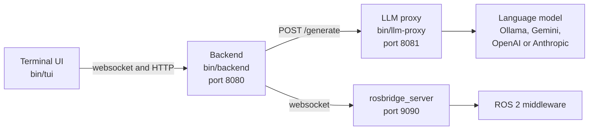

# Embodied AI Proxy


The proxy turns an instruction in natural language into a recipe for the [Kinova Gen3 Lite ROS 2 middleware](https://github.com/Jeremy-Allan/ROS2-middleware). It builds a prompt, asks a language model for a recipe, checks the answer against a JSON schema and against the names of the objects in the scene, and sends the recipe to the middleware to run.

The proxy consists of three Go programs: a backend, an LLM proxy and a terminal UI. It does not use ROS 2. It reaches the middleware through the websocket of `rosbridge_server`. The middleware, its actions and its recipes are described in the [Kinova Middleware Manual](https://jeremy-allan.github.io/ROS2-middleware/).

The system was developed for the Swinburne University Cyber Lab to study how language models respond to instructions for a robot arm, including malicious instructions.

The diagram shows the programs, their ports and their connections.



## Quick start

The proxy needs Go 1.26.5 or later and a language model. The default is the Ollama model `gemma3:1b`. See [Installation](docs/installation/installation.md).

```bash
git clone https://github.com/paul-isit/embodied-ai-proxy.git
cd embodied-ai-proxy
./run.sh --build
```

The script builds the programs, starts the LLM proxy and the backend in the background, and opens the terminal UI. Commands run only while the middleware is running. See [Run the proxy](docs/user-guide/running.md).

## Documentation

| Section | Pages |
|---|---|
| Installation | [Installation](docs/installation/installation.md), [Configuration](docs/installation/configuration.md) |
| User guide | [Run the proxy](docs/user-guide/running.md), [Terminal UI](docs/user-guide/terminal-ui.md), [Evaluate a language model](docs/user-guide/evaluation.md), [Troubleshooting](docs/user-guide/troubleshooting.md) |
| Technical | [Architecture](docs/technical/architecture.md), [Command pipeline](docs/technical/command-pipeline.md), [Prompt and schema](docs/technical/prompt-and-schema.md), [Interfaces](docs/technical/interfaces.md) |

## Repository layout

```text
backend/       Backend: websocket hub, command pipeline, rosbridge client, evaluation runner
llm-proxy/     LLM proxy: provider adapters and routing
tui/           Terminal UI
shared/        Configuration, logging and HTTP server helpers
data/config/   config.json, json_schema.json and system_prompt.md
tests/         Test suites for the evaluation runner
docs/          Documentation
run.sh         Builds and starts the programs
go.work        Go workspace of the four modules
```

## License

Apache License 2.0. See [LICENSE](LICENSE).
