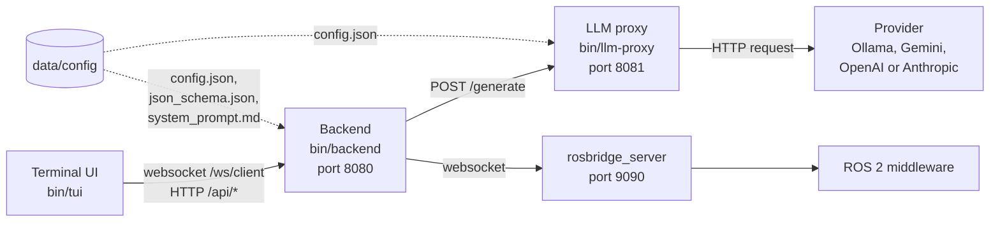
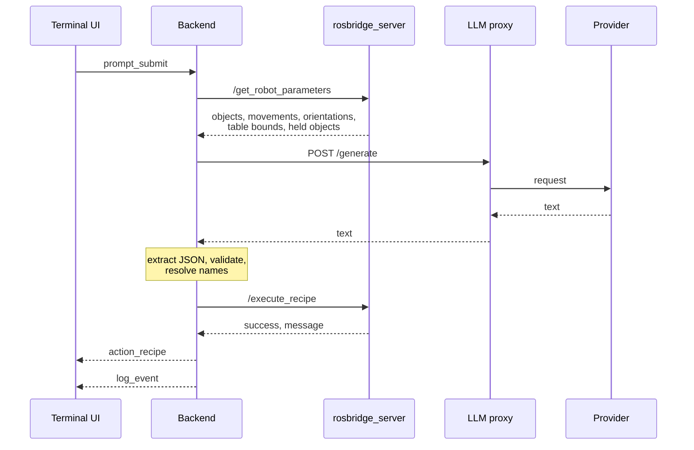

# Architecture

The proxy consists of three programs that communicate over HTTP and websockets: the terminal UI, the backend and the LLM proxy. The backend holds the logic. It is the only program that talks to the middleware.

The diagram shows the programs, their ports and the configuration files that they read.



| Program | Role |
|---|---|
| Backend | Accepts one terminal UI. Reads the scene from the middleware, builds the prompt, validates the answer of the model, resolves names and sends the recipe to the middleware. Runs the evaluation suites. |
| LLM proxy | Sends a prompt to the configured provider and returns the text. Applies a time limit and one retry. |
| Terminal UI | Sends commands to the backend. Shows the recipes, the results and the status of the middleware. |

## Request flow

The sequence shows one command from the terminal UI to the robot.



The backend reads the scene before every command. A change of the objects in the middleware applies to the next command without a restart. The backend also forwards each `/system/status` message of the middleware to the terminal UI.

The steps between the model and the robot are described in [Command pipeline](command-pipeline.md). The messages are described in [Interfaces](interfaces.md).

## Limits and timeouts

| Limit | Value |
|---|---|
| Read of the scene before a command | 5 s. On failure the backend uses the last values and treats the held object as unknown. |
| Request from the backend to the LLM proxy | 60 s. |
| Request from the LLM proxy to the provider | `proxy.llm_config.timeout_seconds`, default 30 s, including the retry. |
| Retry of a provider request | One retry after 250 ms, for a connection error, the HTTP status 429 or a 5xx status. No retry after a timeout or another status. |
| Recipe on the middleware | `server.execution_timeout_seconds`, default 300 s. |
| One command, from receipt to result | 5 minutes. |
| Reconnection of the backend to `rosbridge_server` | Every 2 s. |
| Reconnection of the terminal UI to the backend | 1 s, doubling to 30 s. |
| Wait for a result in the terminal UI | 300 s. |
| `/scan` | 30 s in the backend, 35 s in the terminal UI. |
| `/reset-env` | 10 s in the terminal UI. |
| Request body of `/generate` | 1 MiB. |
| Answer of a provider | 4 MiB. |
| Shutdown of a program | 10 s. |

## Security

- The backend and the LLM proxy have no authentication. They listen on all network interfaces, and the backend accepts websocket connections from any origin. Restrict access to the ports 8080 and 8081 with the firewall of the host.
- `rosbridge_server` has no authentication either. See [Safety and contracts](https://jeremy-allan.github.io/ROS2-middleware/technical/safety-and-contracts/) in the manual of the middleware.
- The proxy does not judge whether a recipe is safe. A recipe that satisfies the schema and the name resolution goes to the middleware. Only the model can return the error type `safety_violation`.
- `config.json` holds the API key in plain text. The logs contain the commands and the full prompts. Restrict access to both.

## Repository layout

```text
embodied-ai-proxy/
  run.sh                     Builds and starts the programs
  go.work                    Go workspace of the four modules
  data/
    config/                  config.json, json_schema.json, system_prompt.md
    logs/                    Log files, created at run time
  backend/
    cmd/server/              Entry point. The option -eval runs test suites.
    internal/
      api/                   Handlers of /api/info, /api/reset and /api/scan
      eval/                  Runner of the test suites
      matcher/               Matching of names
      pipeline/              Prompt, model call, validation, name resolution, retry, execution
      rosbridge/             Client of rosbridge_server
      server/                Start-up and routes
      validator/             Validation against the JSON schema
      websocket/             Hub of /ws/client
  llm-proxy/
    cmd/server/              Entry point
    internal/
      api/                   Handler of POST /generate
      provider/              Adapters: ollama, gemini, openai, anthropic
      router/                Choice of the provider, time limit, retry
      server/                Start-up and routes
  tui/
    cmd/tui/                 Entry point
    internal/
      app/                   Model, update and view of the terminal UI
      client/                Websocket and HTTP clients of the backend
  shared/
    config/                  Loading of config.json
    httpserver/              HTTP server with graceful shutdown
    logging/                 Log to the terminal and to a file
  tests/                     Test suites for the evaluation runner
```

## Build and test

The programs are built with `go build`. See [Installation](../installation/installation.md#install-the-proxy). Run the unit tests of the four modules from the folder of the proxy:

```bash
go test ./backend/... ./llm-proxy/... ./shared/... ./tui/...
```

The packages are in the folder `internal` of their module, except `shared/config`.

| Module | Package | Covers |
|---|---|---|
| `backend` | `api` | The HTTP handlers. |
| | `eval` | The comparison of results and the report. |
| | `matcher` | The matching of names. |
| | `pipeline` | Prompt, JSON extraction, name resolution, retry and command handling. |
| | `rosbridge` | The client of `rosbridge_server`. |
| | `validator` | The recipe schema. |
| | `websocket` | The hub. |
| `llm-proxy` | `api` | `POST /generate`. |
| | `router` | Provider choice, time limit and retry. |
| | `provider/*` | The four adapters. |
| `shared` | `config` | The loading of `config.json`. |
| `tui` | `app` | The model, the update and the view. |
| | `client` | The websocket and HTTP clients. |
