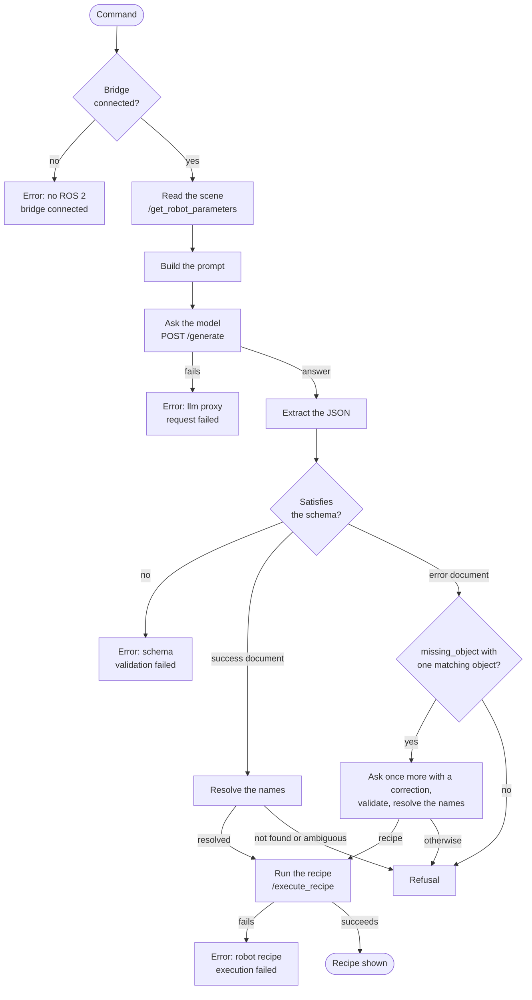

# Command pipeline

The command pipeline turns the text of a command into a checked recipe and runs it on the middleware. The evaluation of a language model uses the same pipeline up to the execution. See [Evaluate a language model](../user-guide/evaluation.md).

The flowchart shows the steps and the outcomes. Boxes that start with `Error` end the command with an `[ERR]` entry in the terminal UI. The box `Refusal` ends it with a `[SYS]` entry that holds the reason.

## Steps

| Step | What happens | Failure |
|---|---|---|
| Receive | The hub receives `prompt_submit`. One command, from receipt to result, has 5 minutes. | `command rejected: another command is currently in progress` when a command already runs. |
| Check the bridge | The backend checks the connection to `rosbridge_server`. | `cannot execute commands: no ROS 2 bridge connected`. |
| Read the scene | The service `/get_robot_parameters` returns the names of the objects, movements and orientations, the bounds of the table and the held objects. The call has 5 s. | The backend uses the last values and treats the held object as unknown. |
| Build the prompt | The placeholders of the template are replaced. See [Prompt and schema](prompt-and-schema.md). | None. |
| Ask the model | `POST /generate` on the LLM proxy, with 60 s. | `llm proxy request failed: ...` or `llm proxy error: ...`. |
| Extract the JSON | The backend removes the Markdown code fence of the answer. If the text is still not valid JSON, it takes the text from the first `{` to the last `}`. | None. The next step reports an unusable text. |
| Validate | The JSON is checked against `json_schema.json`. The answer must be a success document or an error document. | `schema validation failed: ...`. |
| Resolve the names | For a success document, each name is matched with the live names. See [Name resolution](#name-resolution). | An error document, shown as a refusal. |
| Retry | For an error document of the type `missing_object`. See [Retry](#retry). | The refusal of the model. |
| Run | The recipe goes to `/execute_recipe` and the backend waits for the result. See [Execution](#execution). | `robot recipe execution failed: ...`. |

## Name resolution

The backend resolves the values of these parameters of every step with the names that the middleware reports:

| Parameter | Resolved with |
|---|---|
| `target`, `destination` | Objects. |
| `vector` | Movements. |
| `orientation` | Orientations. |

The rules for one value:

1. A value that equals a registered name stays unchanged.
2. Otherwise the value and the registered names are normalized: lower case, and each run of characters other than letters and digits becomes one space. A registered name is a candidate when one of these holds:
    - The similarity is at least 0.7. The similarity is 1 minus the edit distance divided by the length of the longer text.
    - Each word of the value is a word of the name. The words `the`, `a`, `an`, `it`, `its`, `this`, `that`, `up`, `to`, `please` and `one` are removed from the value first.
3. With one candidate, the value is replaced by the registered name. With several candidates, the command ends with an `invalid_command` error document. With none, it ends with a `missing_object` error document.

| Value | Objects | Result |
|---|---|---|
| `blu cube` | `blue_cube`, `delivery_tray` | `blue_cube`. The similarity is 0.89. |
| `the cube` | `blue_cube`, `delivery_tray` | `blue_cube`. |
| `the cube` | `blue_cube`, `red_cube` | `invalid_command`: the name matches more than one object. |
| `red sphere` | `blue_cube`, `delivery_tray` | `missing_object`. |

The messages of the error documents are:

- `Execution aborted. Referenced object 'red sphere' was not found in the environment map. Available: blue_cube, delivery_tray.` The word `object` is `movement` or `orientation` for the other parameters.
- `Execution aborted. 'the cube' matches more than one object (blue_cube, red_cube), and the command doesn't say which. Please specify which one.`

The recipe that the middleware receives and the terminal UI shows contains the resolved names.

## Retry

The model can refuse a command by itself with an error document of the type `missing_object`. The backend takes the first term in quotes from its message and resolves it with the objects:

- With one matching object, the backend sends the prompt once more, with a correction that names the registered object. The new answer is validated and its names are resolved. A valid recipe continues the command, and a second error document is shown as it is. If the second request fails or the answer is invalid, the first refusal is shown.
- With several matching objects, the backend sends no second request. It ends the command with the `invalid_command` message above.
- With no match, or without a term in quotes, the refusal of the model is shown unchanged.

Error documents of the types `invalid_command` and `safety_violation` are shown as the model returns them.

## Execution

- The backend sends the recipe, after name resolution, as `recipe_json` to the service `/execute_recipe`, and waits up to `server.execution_timeout_seconds`.
- The middleware runs the steps in order and stops at the first step that fails. See the [Recipes](https://jeremy-allan.github.io/ROS2-middleware/user-guide/recipes/) page of the middleware.
- When the middleware reports success, the backend sends the recipe to the terminal UI as `action_recipe`, followed by a `log_event` message `recipe "<name>" executed successfully by robot`. The terminal UI therefore shows the recipe after the robot has finished.
- When the middleware reports a failure, the backend sends `robot recipe execution failed: recipe execution failed: <message>`. The message of the middleware names the step.
- When the backend stops waiting because of a time limit, it does not cancel the recipe. The middleware continues until the recipe ends.

## Results in the terminal UI

| Outcome | Message from the backend | Entry in the log |
|---|---|---|
| Recipe executed | `action_recipe`, then `log_event` with the level `info`. | `[OK]` with the steps, then `[SYS]`. |
| Refusal | `log_event` with the error document. | `[SYS]` with the `message` of the document. |
| Error of the bridge, the model, the validation or the execution | `log_event` with the level `error`. | `[ERR]`. |
