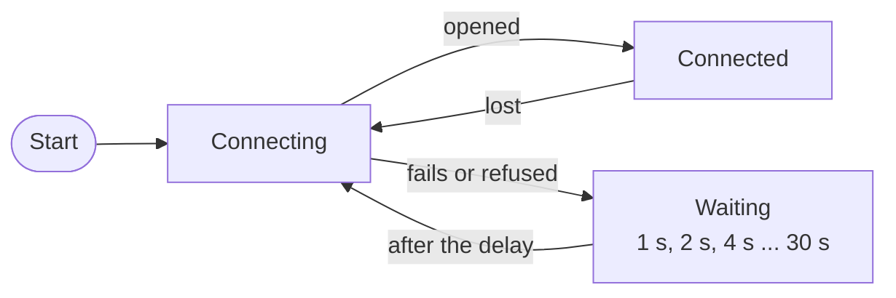

# Terminal UI

The terminal UI is the operator interface of the proxy. It sends commands to the backend, shows the recipe and the result of each command, and shows the status of the middleware.

## Start the terminal UI

`run.sh` starts the terminal UI. To start it alone, run:

```bash
./bin/tui -serverURL http://localhost:8080 -dataDir data
```

`-serverURL` is the address of the backend. `-dataDir` is the folder for `logs/tui.log` and the saved sessions. The terminal UI fills the terminal window. The mouse wheel scrolls the log.

## Screen

The screen has a header, a log, an input line and a sidebar. The header has three lines:

```text
Backend: http://localhost:8080 [connected] | bridge: connected
LLM: ollama/gemma3:1b
Objects: water_bottle, tea_pot, blue_cube, tea_cup, delivery_tray, coaster
```

| Part | Contents |
|---|---|
| First header line | The address of the backend, the connection to it (`connected`, or `disconnected (<reason>) - reconnecting...`) and the bridge to the middleware (`connected`, `disconnected` or `unknown`). |
| Second header line | The provider and the model, read from the backend at start. |
| Third header line | The names of the objects. The line shows `(none discovered yet)` until the first command or `/scan` has read the objects from the middleware. |
| Log | The commands, recipes and results of the session. |
| Status line | While a command runs: a spinner, `waiting for response...` and the elapsed time. |
| Input line | One line. Enter sends it. |
| Sidebar | The status of the middleware. See [Sidebar](#sidebar). |

The log marks each entry with a tag:

| Tag | Meaning |
|---|---|
| `[USER]` | A command. |
| `[OK]` | A validated recipe. |
| `[SYS]` | Information, and the refusal of a command. |
| `[ERR]` | An error. |
| `[EXEC]` | A status message of `kinova_hardware_client`, at detail level L3. |

## Send a command

1. Type the instruction in the input line and press Enter.
2. Wait for the result. The log shows the recipe after the middleware has finished it:

    ```text
    [USER] pick up the blue cube and put it on the delivery tray

    [OK] Validated Robot Recipe: Move Cube to Tray
      1. home - Start at home
      2. pickup - Pick up the blue cube
      3. dropoff - Place it on the tray
      4. home - Return home

    [SYS] recipe "Move Cube to Tray" executed successfully by robot
    ```

- One command runs at a time. Enter does nothing while a command runs, and the backend refuses a second command.
- If no result arrives within 300 s, the terminal UI shows `No response received within 300s - you can try again.` and accepts a new command.
- A command that the model or the name resolution refuses appears as a `[SYS]` entry with the reason, without `[OK]`. A failure appears as an `[ERR]` entry. See [Troubleshooting](troubleshooting.md) and [Command pipeline](../technical/command-pipeline.md).

## Commands of the terminal UI

A line that starts with `/` is a command of the terminal UI and is not sent to the model. Command names are not case-sensitive. An unknown name shows `unknown command: /<name> (try /help)`.

| Command | Description |
|---|---|
| `/help`, `/h` | Shows the keys and the commands. |
| `/filtered` | Sets detail level L1. |
| `/context` | Sets detail level L2. |
| `/debug` | Sets detail level L3. |
| `/system`, `/sys` | Shows the state of the bridge, the number of connected terminal UIs, `server.port` and `server.proxy_url`. |
| `/llm` | Shows the provider, the model, `max_tokens` and `temperature`. |
| `/sidebar` | Shows or hides the sidebar. |
| `/save` | Writes the log to `<dataDir>/logs/session_<yyyymmdd>_<hhmmss>.txt` and shows the path. |
| `/copy` | Copies the last command and its answer to the clipboard. |
| `/reset-env` | Restores the objects and obstacles of the middleware to the configured state and clears the held object. The middleware service `/reset_environment` does this. |
| `/scan` | Takes a camera snapshot, updates the objects of the middleware and lists the objects added and removed. The middleware must run with `enable_CV:=true`. |

## Keys

| Key | Action |
|---|---|
| Enter | Sends the command. |
| Up, Down | Recall the earlier commands. The unfinished line is kept. |
| Page Up, Page Down | Scroll the log. |
| Home, End | Jump to the start or the end of the log. |
| Ctrl+C | Quit. |

## Detail levels

| Level and command | Shows |
|---|---|
| L1, `/filtered` | The name of the recipe and the action and description of each step. This is the default. |
| L2, `/context` | Adds the parameters of each step and the recipe as JSON, after the names are resolved. |
| L3, `/debug` | Adds the duration and the number of steps, and the status messages of `kinova_hardware_client` as `[EXEC]` entries. |

## Sidebar

- `MIDDLEWARE STATUS` shows `System: READY`, `BUSY` or `FAULT`, and one entry for each node with its state and status message. These come from `/system/status`. The panel shows `No telemetry yet` until the first message arrives.
- `CURRENT EXECUTION` lists the status messages of `kinova_hardware_client` with the time, since the last command. It shows `No prompt running` when the list is empty.

## Connection

The terminal UI keeps the connection to the backend. When the connection fails or is lost, it tries again after 1 s, then after 2 s, 4 s and so on up to 30 s. After a successful connection the delay starts again at 1 s.



The backend accepts one terminal UI. A second terminal UI shows `status 409 Conflict` in the header and keeps trying until the first one closes.

## Saved sessions

`/save` writes the entries of the log without colours. The file starts with the time and the address of the backend:

```text
Session export - Fri, 23 Oct 2026 12:29:01 AEDT
Backend: http://localhost:8080
------------------------------------------------------------
```

`/copy` needs a clipboard tool: `xclip`, `xsel` or `wl-clipboard` on Linux, and `clip.exe` on WSL. Without one, the log shows `failed to copy to clipboard: <reason>`.
